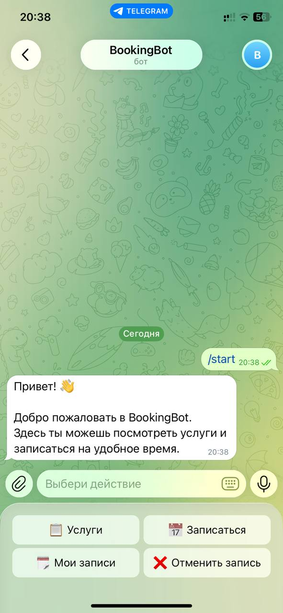
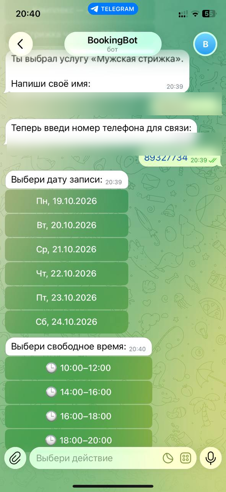
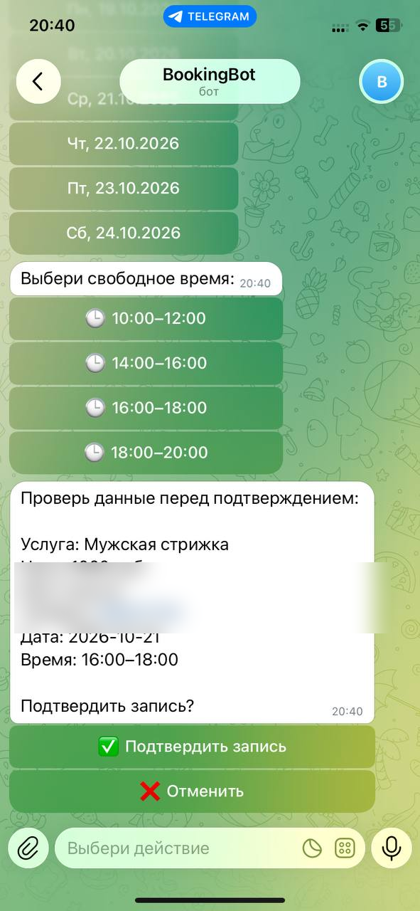
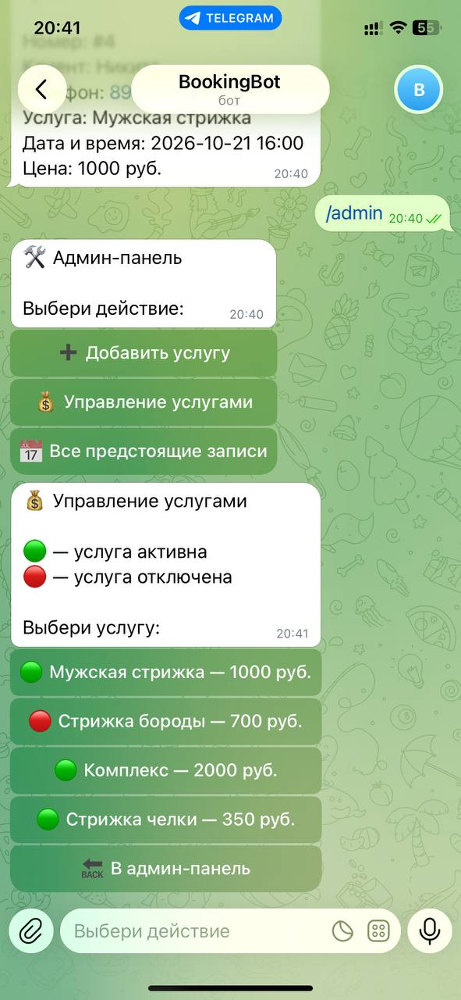
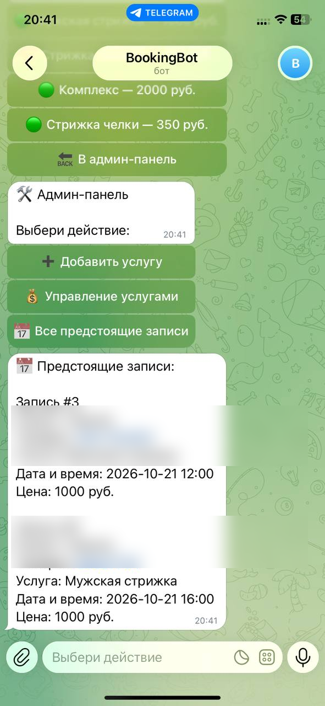

# 📅 BookingBot

**Telegram-бот для онлайн-записи клиентов на услуги с административной панелью.**

BookingBot автоматизирует процесс записи: клиент выбирает услугу, указывает контактные данные, выбирает дату и свободное время, а администратор управляет услугами и просматривает записи.

Проект разработан на Python с использованием aiogram 3 и SQLite.

[Возможности](#-возможности) · [Скриншоты](#-скриншоты) · [Технологии](#-технологии) · [Установка](#-установка-и-запуск)

---

## ✨ Возможности

### 👤 Для клиентов

- Просмотр доступных услуг и их стоимости.
- Выбор услуги для записи.
- Выбор доступной даты и времени.
- Оформление записи с указанием имени и телефона.
- Просмотр собственных записей.
- Отмена будущих записей.

### 🛠 Для администратора

- Доступ к административной панели.
- Добавление новых услуг.
- Изменение стоимости услуг.
- Включение и отключение услуг.
- Просмотр предстоящих записей клиентов.

### 🗄 Хранение данных

- SQLite для хранения услуг и записей.
- Сохранение информации между перезапусками бота.
- Разделение логики проекта по модулям.

## 📸 Скриншоты

Ниже представлены реальные скриншоты работающего Telegram-бота.

### Главное меню



### Выбор даты и времени



### Подтверждение записи



### Управление услугами



### Просмотр предстоящих записей



## 🧰 Технологии

| Технология | Назначение |
|---|---|
| Python | Основной язык программирования |
| aiogram 3 | Telegram Bot API |
| SQLite | Хранение данных |
| aiosqlite | Асинхронная работа с базой данных |
| python-dotenv | Загрузка конфигурации из `.env` |

## 📁 Структура проекта

```text
BookingBot/
├── database/          # Работа с базой данных
├── handlers/          # Обработчики событий и сообщений
├── keyboards/         # Клавиатуры Telegram
├── states/             # Состояния пользовательских сценариев
├── screenshots/        # Скриншоты для документации
├── bot.py              # Точка входа приложения
├── config.py           # Конфигурация
├── requirements.txt    # Зависимости проекта
├── .env.example        # Пример переменных окружения
├── .gitignore          # Исключения Git
└── README.md           # Документация проекта
```

## 🚀 Установка и запуск

### Требования

- Python 3.10 или новее.
- Telegram-аккаунт.
- Токен Telegram-бота, полученный через [@BotFather](https://t.me/BotFather).

### 1. Клонирование репозитория

```bash
git clone https://github.com/Gobiarr/BookingBot.git
cd BookingBot
```

### 2. Создание виртуального окружения

Windows PowerShell:

```powershell
python -m venv .venv
.venv\Scripts\Activate.ps1
```

### 3. Установка зависимостей

```powershell
pip install -r requirements.txt
```

### 4. Настройка конфигурации

Создай файл `.env` в корневой папке проекта на основе `.env.example`.

Укажи собственные значения:

```dotenv
BOT_TOKEN=your_telegram_bot_token
ADMIN_ID=your_telegram_user_id
```

- `BOT_TOKEN` — токен Telegram-бота.
- `ADMIN_ID` — числовой Telegram ID администратора.

Не публикуй `.env` и не передавай токен бота другим людям.

### 5. Запуск бота

```powershell
python bot.py
```

После запуска открой своего бота в Telegram и отправь команду `/start`.

## 🔐 Безопасность

- Секретные настройки хранятся в `.env`.
- Файл `.env` должен быть исключён из Git.
- Доступ к административным функциям ограничивается по Telegram ID.

## 🎯 Цель проекта

BookingBot — портфолио-проект, демонстрирующий практические навыки разработки Telegram-ботов на Python.

В ходе разработки реализованы пользовательские сценарии записи, хранение данных в SQLite, управление услугами и административные функции.

## 👨‍💻 Автор

**GitHub:** [Gobiarr](https://github.com/Gobiarr)

**Репозиторий:** [Gobiarr/BookingBot](https://github.com/Gobiarr/BookingBot)

---

*BookingBot — удобная запись клиентов через Telegram.*
